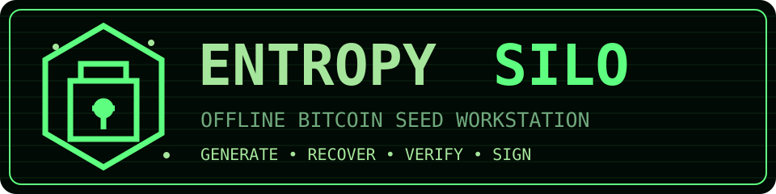
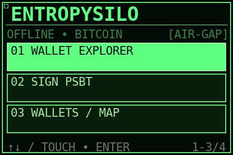
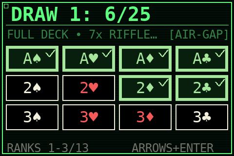
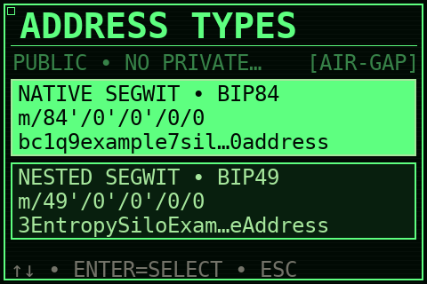
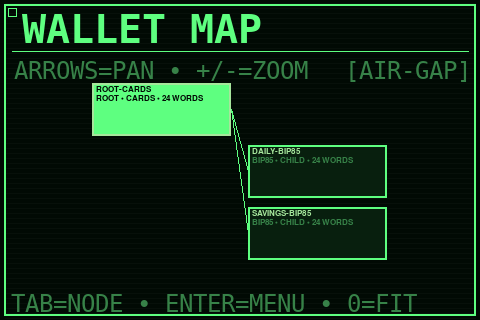
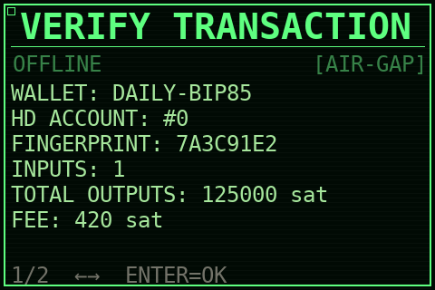

**Language:** [English](README.md) | [Polski](README.pl.md)

<p align="center">
  
</p>

<p align="center">
  <strong>Offline Bitcoin Seed Workstation &amp; PSBT Signer</strong><br>
  Generate with evidence. Recover deterministically. Sign offline.
</p>

<p align="center">
  
  
  
  
  
  
</p>

EntropySilo is a security-focused, offline environment for generating, recovering, organizing and using Bitcoin wallets. It combines full-entropy BIP39 seed generation, physical card-derived randomness, the first-party [Seed Generator Wallet Decoder](https://github.com/hattimon/Seed-Generator-Wallet-Decoder) and [wallet-decoder](https://github.com/hattimon/wallet-decoder) projects by hattimon, deterministic BIP85 child wallets, watch-only exports and offline PSBT signing.

EntropySilo provides separate build targets for Raspberry Pi 2 Model B with the Waveshare 3.5inch RPi LCD (A) and for x86-64 laptops/PCs as a Live image. The Live ISO can be written to a USB drive or burned to CD/DVD for systems that support optical boot. The 0.3 release series uses EntropySilo naming and paths throughout both systems. Release images are published only after their automated build validation completes; always verify recovery and the complete signing workflow with a small test amount before protecting substantial funds.

> [!WARNING]
> EntropySilo is an experimental, independently built signer. It is not equivalent to a certified hardware wallet and has not yet undergone an independent professional security audit. Raspberry Pi 2 has no secure element, verified/measured boot or tamper-resistant enclosure. Test recovery and the complete signing workflow with an empty wallet or a small amount before protecting real funds.

## 🔐 Why EntropySilo

- **Full 256-bit BIP39 entropy:** every newly generated wallet uses 32 bytes of entropy followed by the BIP39 checksum, producing a 24-word mnemonic.
- **Physical card entropy:** an alternative workflow uses two independently shuffled 25-card draws, interaction timing, optional user-provided entropy and an independent operating-system CSPRNG contribution.
- **First-party SWD integration:** reversible `swd1` and `swd2` recovery codes can recreate the exact original mnemonic. A separate legacy mode implements the intentionally one-way `password + number` wallet-decoder workflow.
- **Air-gapped operation:** wallet generation, key derivation and transaction signing take place without a network connection.
- **Verifiable transfer:** public wallet information and unsigned/signed PSBT data can move through QR codes or a tightly constrained USB workflow without exporting private keys.
- **Deterministic wallet hierarchy:** BIP85 child wallets and the wallet map make the origin of imported and derived wallets visible.
- **Accessible interface:** the complete interface supports touch and USB keyboard navigation, with Polish and English language modes and both Simple and Advanced workflows.

## 🖥️ Interface preview

The images below are deterministic documentation previews rendered from the real 480×320 GUI components. Wallet names, addresses and transaction values are demonstration data—not live secrets or real payment instructions.

<table>
  <tr>
    <td width="50%"><br><strong>Fast, keyboard- and touch-friendly navigation</strong></td>
    <td width="50%"><br><strong>Ordered card entry with visible green selection state</strong></td>
  </tr>
  <tr>
    <td><br><strong>Clearly labelled BIP44/49/84/86 address standards</strong></td>
    <td><br><strong>Zoomable wallet-origin and BIP85 hierarchy map</strong></td>
  </tr>
  <tr>
    <td colspan="2" align="center"><br><strong>On-device wallet, account, output and fee verification before signing</strong></td>
  </tr>
</table>

## 🎲 Entropy generation

### System CSPRNG

The system generator requests exactly 32 bytes from Node.js `crypto.randomBytes`, which is backed by the operating-system cryptographic random-number generator. It does not use `Math.random`, truncate a smaller random pool or reduce the result modulo a limited range.

### Cards plus independent system entropy

The card workflow requires:

1. 25 unique cards drawn from a shuffled 52-card deck;
2. a complete reshuffle;
3. another 25 unique-card draw;
4. interaction timing data;
5. optional user-provided entropy;
6. an independent 32-byte system CSPRNG value.

The ordered card space is `(52P25)^2`, approximately `2^264.89`. All inputs are domain-separated and combined with SHA-256. The final BIP39 entropy is still exactly 256 bits—additional sources improve resilience but cannot increase the security level beyond the 256-bit output space.

The EntropySilo card workflow is an independent implementation. **[Rav3nPL](https://github.com/Rav3nPL), author of [Rav3nPL/SeedGenerator](https://github.com/Rav3nPL/SeedGenerator/tree/master), is explicitly credited as the originator of the SeedGenerator card- and click-timing concept that inspired this workflow.** SeedGenerator source code, wordlist, icons and assets are not redistributed by EntropySilo.

## 🔑 Seed Generator Wallet Decoder

EntropySilo integrates hattimon's first-party [Seed Generator Wallet Decoder](https://github.com/hattimon/Seed-Generator-Wallet-Decoder):

- `swd1` and `swd2` encode a valid BIP39 mnemonic into a password-and-number recovery code and decode it back to the identical mnemonic;
- `swd2` uses a case-sensitive `a-zA-Z` alphabet to encode the entropy prefix more compactly;
- the legacy mode is compatible with hattimon's [wallet-decoder](https://github.com/hattimon/wallet-decoder) algorithm and is intentionally one-way;
- word-count suffixes `:12` and `:24` are supported, with 24 words used when the suffix is omitted.

An SWD password and number contain the same secret entropy as the mnemonic they represent. They are an alternative recovery representation and must be backed up and protected with the same care as seed words.

## ₿ Bitcoin wallet capabilities

- BIP39 import and 24-word generation;
- BIP44 Legacy (`m/44'/0'/...`);
- BIP49 Nested SegWit (`m/49'/0'/...`);
- BIP84 Native SegWit (`m/84'/0'/...`);
- BIP86 Taproot (`m/86'/0'/...`);
- deterministic BIP85 child mnemonics;
- public address and QR display;
- watch-only descriptor and extended-public-key export;
- wallet, account, change branch and address-index selection;
- interactive wallet-origin map;
- PSBT inspection and offline signing;
- QR image, UVC camera, HDMI-to-USB capture and USB-file import;
- encrypted, numbered USB backups without overwriting existing files.

## 🔒 Security architecture

- AES-256-GCM encrypted vault;
- key derivation from a 12-digit PIN using scrypt (`N=131072`, `r=8`, `p=1`);
- authenticated origin metadata in the current vault format;
- disabled swap, core dumps and persistent application logs;
- GUI isolation with `NoNewPrivileges=yes`;
- no `sudo` package in the finished appliance image;
- a narrow privileged broker exposed only through a local Unix socket;
- nftables drop-all policy and disabled/masked network services;
- blacklisted Wi-Fi and Bluetooth modules;
- removable media mounted only for one operation with `noexec,nosuid,nodev`;
- USB operations limited to regular, size-bounded files under `/EntropySilo`;
- encrypted backups written directly to USB without a plaintext working file on the SD card.

Secrets must briefly exist in RAM while a key is derived or a transaction is signed. No general-purpose Raspberry Pi can guarantee protection against a hostile administrator, compromised firmware, physical implants or forensic attacks against copied storage. Read the full [security model](SECURITY.md) before use.

## 🖥️ Interface and workflow

- English/Polish first-run wizard, with English as the default;
- Simple mode for guided receiving, watch-only export and transaction signing;
- Advanced mode for derivation paths, wallet standards, BIP85 and specialist settings;
- touch control and complete USB keyboard navigation;
- virtual keyboard with arrow-key selection and Enter confirmation;
- PIN-protected factory reset;
- five lightweight themes: Mono, Phosphor, Amber, Cobalt and Crimson.

## 📁 USB structure

The USB interoperability directory is `/EntropySilo` on both the Raspberry Pi 2 and Live USB editions.

```text
/EntropySilo/
+¦¦ import.txt
+¦¦ transaction.psbt
+¦¦ unsigned-qr.png
+¦¦ backup.eswb
+¦¦ backup1.eswb
L¦¦ backup2.eswb
```

The application never executes scripts from removable media. It operates only on explicitly supported files in this directory and does not delete or overwrite unrelated files.

## ⬇️ Official downloads

The **only official distribution channel** is [GitHub Releases](https://github.com/hattimon/EntropySilo/releases). System images are release assets and are never committed to the Git repository.

Every downloadable image must be accompanied by:

- an exact version and hardware target in the filename;
- a `.sha256` checksum file;
- a matching `.txt` compatibility and validation report;
- release notes describing security-relevant changes.

Always verify SHA-256 before writing an image to an SD card or USB drive. A backup mirror may be announced later by hattimon, but it will not replace GitHub Releases as the official source.

## 🤖 Supported hardware and images

| Target | Architecture | Display | Status |
|---|---:|---|---|
| Raspberry Pi 2 Model B | ARMv7 / 32-bit | Waveshare 3.5inch RPi LCD (A), 480x320 | 0.3.0 build complete; released in v0.3.0 GitHub release |
| Raspberry Pi 3 | ARM64 | Waveshare 3.5inch RPi LCD (A) | Planned as a separate image |
| Raspberry Pi 4/5 | ARM64 | Waveshare 3.5inch RPi LCD (A) | Planned as a separate image |
| PC Live USB / CD/DVD | x86-64 | Generic display, keyboard, mouse/touch and UVC camera | 0.3.2 display/USB hotfix; automated ISO validation and physical laptop boot/display test complete |

Current platform-specific release artifacts:

```text
EntropySilo-Pi2-Bookworm-0.3.0.img.xz
EntropySilo-Live-x86_64-0.3.2.iso
```

#### ⬇️ Direct download links

| Platform | Image | Download |
|---|---|---|
| 🔌 Raspberry Pi 2 | EntropySilo-Pi2-Bookworm-0.3.0.img.xz | [⬇️ Download](https://github.com/hattimon/EntropySilo/releases/download/v0.3.0/EntropySilo-Pi2-Bookworm-0.3.0.img.xz) |
| 💻 PC Live USB (x86-64) | EntropySilo-Live-x86_64-0.3.2.iso | [⬇️ Download](https://github.com/hattimon/EntropySilo/releases/download/v0.3.2/EntropySilo-Live-x86_64-0.3.2.iso) |

The Raspberry Pi 2 artifact remains unchanged at 0.3.0. Live USB 0.3.2 fixes native-display fullscreen scaling and detection of a separate USB data drive, including devices that report USB transport but not the removable-media bit. Automated tests, ISO-structure validation and a physical laptop boot/display test have passed. See the matching release pages for `.sha256` checksums and `.txt` compatibility reports.

Each future image will have a matching `.txt` compatibility report. A platform is described as fully workflow-validated only after its complete boot, display, input, backup, recovery and PSBT-signing workflow has been tested on physical hardware.

## 🛠️ Building the Pi 2 image

Requirements: Windows with WSL2/Ubuntu or Linux x86-64, approximately 15 GB of free storage, and network access on the build workstation only.

Windows PowerShell:

```powershell
Set-Location <path-to>\EntropySilo
.\image-builder\build_from_windows.ps1
```

Linux:

```bash
bash image-builder/prepare_assets.sh
sudo bash image-builder/build_image.sh
```

The builder downloads the official Raspberry Pi OS Lite base, verifies pinned assets, provisions the image under QEMU, executes cryptographic regression tests and produces the compressed image plus its SHA-256 checksum.

## 🛠️ Building the x86-64 Live USB image

The Live edition is a separate Debian Bookworm hybrid ISO for 64-bit laptops and PCs. It supports BIOS and UEFI boot, can be written to a USB drive or burned to CD/DVD, runs the interface fullscreen, disables networking, and keeps the vault in the non-persistent Live overlay. Newly generated wallets are intentionally not written to the Live boot medium, and vault changes disappear at shutdown. Keep recovery words on paper and/or create an encrypted backup on a **separate** FAT32/exFAT USB drive in `/EntropySilo`; this separate drive is also used for imports and PSBT exchange. The boot medium is explicitly excluded from data-drive selection.

Windows PowerShell with WSL2/Ubuntu:

```powershell
Set-Location <path-to>\EntropySilo
.\live-builder\build_from_windows.ps1
```

Linux/Debian or Ubuntu:

```bash
sudo ./live-builder/setup_build_host.sh
sudo ./live-builder/build_live.sh
```

Write the resulting `.iso` in raw/DD mode with Raspberry Pi Imager, balenaEtcher, Rufus in DD mode, or `dd`. Secure Boot compatibility depends on the target firmware and must be confirmed on the actual laptop. The generated `.txt` report deliberately distinguishes structural build validation from physical hardware validation.

## ✅ Development tests

```bash
npm ci
npm test
npm run check
npm audit --omit=dev
```

The test suite covers BIP39, card-entropy combination, encrypted vaults, the official BIP85 vector, a real BIP84 PSBT signing flow, vault overwrite protection, broker socket permissions and GUI keyboard navigation.

## 👥 Project ownership and attribution

EntropySilo, [hattimon/Seed-Generator-Wallet-Decoder](https://github.com/hattimon/Seed-Generator-Wallet-Decoder) and [hattimon/wallet-decoder](https://github.com/hattimon/wallet-decoder) are projects by **hattimon**.

**[Rav3nPL](https://github.com/Rav3nPL) is the author and originator of the external [SeedGenerator](https://github.com/Rav3nPL/SeedGenerator/tree/master) project and its card/click-timing generation concept that inspired the related EntropySilo workflow.** EntropySilo does not claim authorship of SeedGenerator and does not redistribute its implementation or assets.

Third-party cryptographic libraries retain their respective licences and notices.

## 📜 Open-source licence

EntropySilo is released under the [MIT License](LICENSE). You may use, inspect, modify and redistribute the project while retaining the copyright and licence notice. Bundled dependencies and third-party components retain their own licences and notices.

## 💝 Support the project

If EntropySilo is useful to you, you can leave hattimon a voluntary tip and help fund hardware testing, security reviews and continued open-source development.

The intended support channels are designed to remain inexpensive both in Poland and internationally:

| Method | Best for | Cost model |
|---|---|---|
| **₿ Bitcoin on-chain** | Larger international tips | Direct payment without a payment processor; the sender pays the Bitcoin network fee. Donation address (SegWit, separate from EntropySilo wallets): `bc1q73wncmalnn4pa8fh742yfzwgmlscfc5lk240aw`. Always verify the address against this repository before sending. |
| **⚡Bitcoin Lightning** | Small international tips | Instant, low-fee tips via Lightning Address. You can send any amount from any Lightning wallet (e.g. Phoenix, Muun, Zeus, Breez). Send to: [verdantdawn594@walletofsatoshi.com](mailto:verdantdawn594@walletofsatoshi.com) (self-custody wallet with seed backup; used only for small tips, not for long-term storage). |

  
Official payment details will be added here only after the receiving addresses and profiles have been verified by hattimon. Never send funds to an address posted in an issue, pull request, comment or unsolicited private message.

#### QR codes for easy payment

| Bitcoin on-chain | Bitcoin Lightning |
|---|---|
| <br>`bc1q73wncmalnn4pa8fh742yfzwgmlscfc5lk240aw` | <br>`verdantdawn594@walletofsatoshi.com` |

