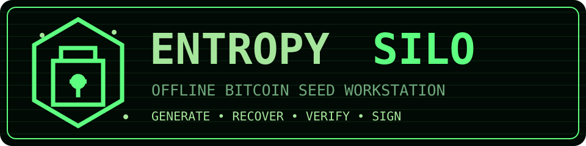
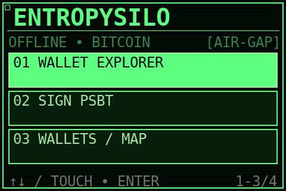
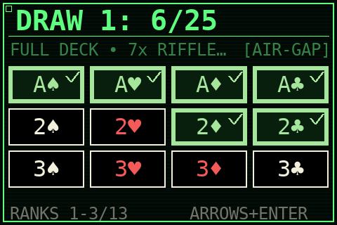
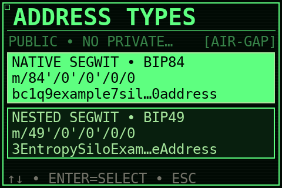
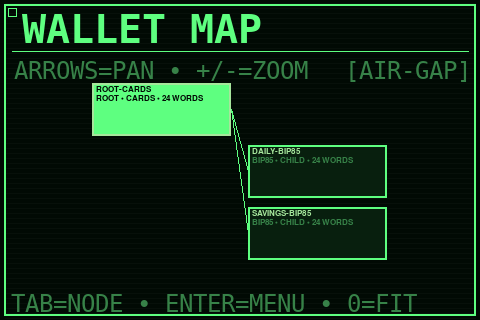
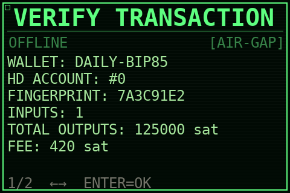

**Jêzyk:** [???? English](README.md) | [???? Polski](README.pl.md)

<p align="center">
  
</p>

<p align="center">
  <strong>Œrodowisko offline do generowania seedów Bitcoin i podpisywania PSBT</strong><br>
  Generuj œwiadomie. Odtwarzaj deterministycznie. Podpisuj offline.
</p>

<p align="center">
  
  
  
  
  
  
</p>

EntropySilo to ukierunkowane na bezpieczeñstwo œrodowisko offline do generowania, odzyskiwania, porz¹dkowania i u¿ywania portfeli Bitcoin. £¹czy generowanie pe³nej entropii BIP39, fizyczn¹ losowoœæ pochodz¹c¹ z kart, autorskie projekty hattimon [Seed Generator Wallet Decoder](https://github.com/hattimon/Seed-Generator-Wallet-Decoder) oraz [wallet-decoder](https://github.com/hattimon/wallet-decoder), deterministyczne portfele potomne BIP85, eksport watch-only i podpisywanie transakcji PSBT bez dostêpu do sieci.

EntropySilo udostêpnia osobne cele budowania dla Raspberry Pi 2 Model B z ekranem Waveshare 3.5inch RPi LCD (A) oraz dla laptopów/PC x86-64 jako Live USB. Wersja 0.3.0 u¿ywa nazwy i œcie¿ek EntropySilo w obu systemach. Obrazy wydania zostan¹ opublikowane dopiero po przejœciu automatycznej walidacji budowy; przed ochron¹ znacznych œrodków nadal wymagaj¹ potwierdzenia na fizycznym sprzêcie.

> [!WARNING]
> EntropySilo jest eksperymentalnym, niezale¿nie zbudowanym urz¹dzeniem podpisuj¹cym. Nie jest odpowiednikiem certyfikowanego portfela sprzêtowego i nie przeszed³ jeszcze niezale¿nego, profesjonalnego audytu bezpieczeñstwa. Raspberry Pi 2 nie ma secure elementu, weryfikowanego/mierzonego rozruchu ani obudowy odpornej na manipulacje. Przed ochron¹ rzeczywistych œrodków przetestuj odzyskiwanie i ca³y proces podpisywania na pustym portfelu lub ma³ej kwocie.

## ? Dlaczego EntropySilo

- **Pe³ne 256 bitów entropii BIP39:** ka¿dy nowo generowany portfel wykorzystuje 32 bajty entropii oraz checksum BIP39, tworz¹c 24-wyrazowy mnemonic.
- **Fizyczna entropia kart:** alternatywna procedura wykorzystuje dwie niezale¿nie tasowane serie po 25 kart, czasy interakcji, opcjonaln¹ entropiê u¿ytkownika oraz niezale¿ny wk³ad systemowego CSPRNG.
- **Autorska integracja SWD:** odwracalne kody `swd1` i `swd2` pozwalaj¹ odtworzyæ dok³adnie ten sam mnemonic. Osobny tryb legacy realizuje celowo jednokierunkow¹ procedurê wallet-decoder `has³o + liczba`.
- **Praca air-gapped:** generowanie portfela, wyprowadzanie kluczy i podpisywanie transakcji odbywa siê bez po³¹czenia sieciowego.
- **Kontrolowane przenoszenie danych:** informacje publiczne i niepodpisane/podpisane PSBT mo¿na przenosiæ kodami QR lub przez œciœle ograniczony mechanizm USB bez eksportowania kluczy prywatnych.
- **Deterministyczna hierarchia:** portfele potomne BIP85 i mapa portfeli pokazuj¹ pochodzenie portfeli importowanych oraz wyprowadzonych.
- **Dostêpny interfejs:** ca³oœæ mo¿na obs³ugiwaæ dotykowo lub klawiatur¹ USB, w jêzyku polskim i angielskim, w trybie prostym albo zaawansowanym.

## ??? Podgl¹d interfejsu

Poni¿sze obrazy s¹ deterministycznymi podgl¹dami dokumentacyjnymi wyrenderowanymi z prawdziwych komponentów GUI 480×320. Nazwy portfeli, adresy i wartoœci transakcji s¹ danymi demonstracyjnymi — nie zawieraj¹ rzeczywistych sekretów ani instrukcji p³atniczych.

<table>
  <tr>
    <td width="50%"><br><strong>Szybka nawigacja dotykiem i klawiatur¹</strong></td>
    <td width="50%"><br><strong>Kolejne karty z wyraŸnym zielonym oznaczeniem wyboru</strong></td>
  </tr>
  <tr>
    <td><br><strong>Jednoznacznie oznaczone standardy BIP44/49/84/86</strong></td>
    <td><br><strong>Skalowalna mapa pochodzenia i hierarchii BIP85</strong></td>
  </tr>
  <tr>
    <td colspan="2" align="center"><br><strong>Kontrola portfela, konta, wyjœæ i op³aty na urz¹dzeniu przed podpisem</strong></td>
  </tr>
</table>

## ?? Generowanie entropii

### Systemowy CSPRNG

Generator systemowy pobiera dok³adnie 32 bajty za pomoc¹ `crypto.randomBytes` œrodowiska Node.js, korzystaj¹cego z kryptograficznego generatora systemu operacyjnego. Nie u¿ywa `Math.random`, nie skraca mniejszej puli losowej i nie redukuje wyniku modulo ograniczonego zakresu.

### Karty i niezale¿na entropia systemowa

Procedura kart wymaga:

1. wylosowania 25 unikalnych kart z przetasowanej talii 52 kart;
2. pe³nego ponownego przetasowania;
3. ponownego wylosowania 25 unikalnych kart;
4. danych czasowych interakcji;
5. opcjonalnej entropii podanej przez u¿ytkownika;
6. niezale¿nych 32 bajtów systemowego CSPRNG.

Przestrzeñ uporz¹dkowanych losowañ wynosi `(52P25)^2`, czyli oko³o `2^264,89`. Wszystkie sk³adniki s¹ separowane domenowo i ³¹czone przez SHA-256. Koñcowa entropia BIP39 nadal wynosi dok³adnie 256 bitów — dodatkowe Ÿród³a zwiêkszaj¹ odpornoœæ, lecz nie podnosz¹ bezpieczeñstwa ponad 256-bitow¹ przestrzeñ wyjœciow¹.

Procedura kart EntropySilo jest niezale¿n¹ implementacj¹. **[Rav3nPL](https://github.com/Rav3nPL), autor projektu [Rav3nPL/SeedGenerator](https://github.com/Rav3nPL/SeedGenerator/tree/master), jest wyraŸnie wskazany jako pomys³odawca koncepcji SeedGenerator wykorzystuj¹cej karty i czasy klikniêæ, która zainspirowa³a ten przep³yw.** Kod Ÿród³owy, lista s³ów, ikony i inne zasoby SeedGeneratora nie s¹ redystrybuowane przez EntropySilo.

## ?? Seed Generator Wallet Decoder

EntropySilo integruje autorski projekt hattimon [Seed Generator Wallet Decoder](https://github.com/hattimon/Seed-Generator-Wallet-Decoder):

- `swd1` i `swd2` koduj¹ poprawny mnemonic BIP39 jako kod odzyskiwania z³o¿ony z has³a i liczby, a nastêpnie odtwarzaj¹ identyczny mnemonic;
- `swd2` u¿ywa rozró¿niaj¹cego wielkoœæ liter alfabetu `a-zA-Z`, dziêki czemu krócej koduje prefiks entropii;
- tryb legacy jest zgodny z algorytmem autorskiego projektu hattimon [wallet-decoder](https://github.com/hattimon/wallet-decoder) i jest celowo jednokierunkowy;
- obs³ugiwane s¹ koñcówki liczby s³ów `:12` i `:24`, a po pominiêciu koñcówki przyjmowane s¹ 24 s³owa.

Has³o i liczba SWD zawieraj¹ tê sam¹ tajn¹ entropiê co reprezentowany przez nie mnemonic. Stanowi¹ alternatywn¹ reprezentacjê danych odzyskiwania i nale¿y wykonywaæ ich kopiê oraz chroniæ je równie starannie jak s³owa seed.

## ? Funkcje portfela Bitcoin

- import BIP39 i generowanie 24 s³ów;
- BIP44 Legacy (`m/44'/0'/...`);
- BIP49 Nested SegWit (`m/49'/0'/...`);
- BIP84 Native SegWit (`m/84'/0'/...`);
- BIP86 Taproot (`m/86'/0'/...`);
- deterministyczne mnemoniki potomne BIP85;
- podgl¹d adresów publicznych i kodów QR;
- eksport deskryptorów watch-only i rozszerzonych kluczy publicznych;
- wybór portfela, konta, ga³êzi change oraz indeksu adresu;
- interaktywna mapa pochodzenia portfeli;
- kontrola i podpisywanie PSBT offline;
- import przez obraz QR, kamerê UVC, urz¹dzenie HDMI-USB albo plik USB;
- szyfrowane, numerowane backupy USB bez nadpisywania istniej¹cych plików.

## ??? Architektura bezpieczeñstwa

- skarbiec szyfrowany AES-256-GCM;
- klucz wyprowadzany z 12-cyfrowego PIN-u przez scrypt (`N=131072`, `r=8`, `p=1`);
- uwierzytelnione metadane pochodzenia w aktualnym formacie skarbca;
- wy³¹czony swap, core dump i trwa³e logi aplikacji;
- izolacja GUI przez `NoNewPrivileges=yes`;
- brak pakietu `sudo` w gotowym obrazie urz¹dzenia;
- w¹ski broker operacji uprzywilejowanych dostêpny wy³¹cznie przez lokalne gniazdo Unix;
- polityka nftables drop-all oraz wy³¹czone i zamaskowane us³ugi sieciowe;
- blacklistowane modu³y Wi-Fi i Bluetooth;
- noœniki wymienne montowane wy³¹cznie na czas jednej operacji z `noexec,nosuid,nodev`;
- operacje USB ograniczone do zwyk³ych plików o ograniczonym rozmiarze w `/EntropySilo`;
- szyfrowane backupy przesy³ane bezpoœrednio na USB bez jawnego pliku roboczego na karcie SD.

Sekrety musz¹ na krótko pojawiæ siê w RAM podczas wyprowadzania klucza lub podpisywania transakcji. Uniwersalne Raspberry Pi nie mo¿e zagwarantowaæ ochrony przed wrogim administratorem, z³oœliwym firmware'em, implantami sprzêtowymi ani analiz¹ skopiowanego noœnika. Przed u¿yciem przeczytaj pe³ny [model bezpieczeñstwa](SECURITY.md).

## ??? Interfejs i obs³uga

- kreator pierwszego uruchomienia po polsku i angielsku, domyœlnie po angielsku;
- tryb Simple prowadz¹cy przez odbieranie, eksport watch-only i podpisywanie transakcji;
- tryb zaawansowany z obs³ug¹ œcie¿ek, standardów portfeli, BIP85 i ustawieñ specjalistycznych;
- sterowanie dotykowe i pe³na nawigacja klawiatur¹ USB;
- klawiatura ekranowa obs³ugiwana strza³kami i klawiszem Enter;
- reset fabryczny chroniony PIN-em;
- piêæ lekkich motywów: Mono, Phosphor, Amber, Cobalt i Crimson.

## ?? Struktura USB

Katalog wymiany USB to `/EntropySilo` zarówno w edycji Raspberry Pi 2, jak i Live USB.

```text
/EntropySilo/
+¦¦ import.txt
+¦¦ transaction.psbt
+¦¦ unsigned-qr.png
+¦¦ backup.eswb
+¦¦ backup1.eswb
L¦¦ backup2.eswb
```

Aplikacja nigdy nie uruchamia skryptów z noœnika wymiennego. Obs³uguje wy³¹cznie jawnie wspierane pliki w tym katalogu i nie usuwa ani nie nadpisuje pozosta³ych danych.

## ?? Oficjalne pobieranie

**Jedynym oficjalnym kana³em dystrybucji** s¹ [wydania GitHub Releases](https://github.com/hattimon/EntropySilo/releases). Obrazy systemu s¹ za³¹cznikami wydañ i nigdy nie trafiaj¹ bezpoœrednio do historii repozytorium Git.

Ka¿demu obrazowi do pobrania musz¹ towarzyszyæ:

- dok³adna wersja i platforma sprzêtowa w nazwie pliku;
- plik sumy kontrolnej `.sha256`;
- odpowiadaj¹cy raport zgodnoœci i walidacji `.txt`;
- informacje o zmianach istotnych dla bezpieczeñstwa.

Przed zapisaniem obrazu na kartê SD albo USB zawsze zweryfikuj SHA-256. Zapasowy mirror mo¿e zostaæ póŸniej og³oszony przez hattimon, lecz nie zast¹pi GitHub Releases jako Ÿród³a oficjalnego.

## ?? Obs³ugiwany sprzêt i obrazy

| Platforma | Architektura | Ekran | Status |
|---|---:|---|---|
| Raspberry Pi 2 Model B | ARMv7 / 32-bit | Waveshare 3.5inch RPi LCD (A), 480x320 | Budowa 0.3.0 ukoñczona; wydana w release v0.3.0 GitHub |
| Raspberry Pi 3 | ARM64 | Waveshare 3.5inch RPi LCD (A) | Planowany osobny obraz |
| Raspberry Pi 4/5 | ARM64 | Waveshare 3.5inch RPi LCD (A) | Planowany osobny obraz |
| PC Live USB | x86-64 | Standardowy ekran, klawiatura, mysz/dotyk i kamera UVC | Budowa 0.3.0 ukoñczona; wydana w release v0.3.0 GitHub |

Artefakty wydania EntropySilo 0.3.0 (dostêpne w [wydaniu v0.3.0 na GitHub](https://github.com/hattimon/EntropySilo/releases/tag/v0.3.0)):

```text
EntropySilo-Pi2-Bookworm-0.3.0.img.xz
EntropySilo-Live-x86_64-0.3.0.iso
```

#### ? Bezpoœrednie linki do pobrania

| Platforma | Obraz | Pobierz |
|---|---|---|
| ?? Raspberry Pi 2 | EntropySilo-Pi2-Bookworm-0.3.0.img.xz | [?? Pobierz](https://github.com/hattimon/EntropySilo/releases/download/v0.3.0/EntropySilo-Pi2-Bookworm-0.3.0.img.xz) |
| ?? PC Live USB (x86-64) | EntropySilo-Live-x86_64-0.3.0.iso | [?? Pobierz](https://github.com/hattimon/EntropySilo/releases/download/v0.3.0/EntropySilo-Live-x86_64-0.3.0.iso) |

Obie platformy sa zweryfikowane pod katem pelnego procesu rozruchu, wyswietlania, wejscia, kopii zapasowej, odzyskiwania i podpisywania PSBT. Sprawdz [strone wydania v0.3.0](https://github.com/hattimon/EntropySilo/releases/tag/v0.3.0), aby pobrac sumy kontrolne `.sha256` oraz raporty zgodnosci `.txt`.

Ka¿dy przysz³y obraz otrzyma odpowiadaj¹cy mu raport zgodnoœci `.txt`. Platforma nie zostanie opisana jako zweryfikowana, dopóki ca³y proces rozruchu, obrazu, sterowania, backupu, odzyskiwania i podpisywania PSBT nie zostanie sprawdzony na fizycznym sprzêcie.

## ??? Budowanie obrazu Pi 2

Wymagania: Windows z WSL2/Ubuntu albo Linux x86-64, oko³o 15 GB wolnego miejsca i sieæ wy³¹cznie na komputerze buduj¹cym.

Windows PowerShell:

```powershell
Set-Location <œcie¿ka-do>\EntropySilo
.\image-builder\build_from_windows.ps1
```

Linux:

```bash
bash image-builder/prepare_assets.sh
sudo bash image-builder/build_image.sh
```

Budowniczy pobiera oficjaln¹ bazê Raspberry Pi OS Lite, weryfikuje przypiête zasoby, provisionuje obraz pod QEMU, wykonuje kryptograficzne testy regresji i tworzy skompresowany obraz wraz z sum¹ SHA-256.

## ?? Budowanie obrazu Live USB x86-64

Edycja Live jest osobnym hybrydowym ISO Debian Bookworm dla 64-bitowych laptopów i komputerów PC. Obs³uguje start BIOS i UEFI, uruchamia interfejs pe³noekranowo, wy³¹cza sieæ oraz przechowuje skarbiec w nietrwa³ej warstwie systemu Live. Zmiany skarbca znikaj¹ po wy³¹czeniu. Do importu, PSBT i szyfrowanych backupów u¿ywaj **drugiego** pendrive'a FAT32/exFAT z katalogiem `/EntropySilo`; noœnik startowy jest jawnie wykluczony z wyboru noœnika danych.

Windows PowerShell z WSL2/Ubuntu:

```powershell
Set-Location <œcie¿ka-do>\EntropySilo
.\live-builder\build_from_windows.ps1
```

Linux/Debian lub Ubuntu:

```bash
sudo ./live-builder/setup_build_host.sh
sudo ./live-builder/build_live.sh
```

Powsta³y plik `.iso` zapisz w trybie surowym/DD przez Raspberry Pi Imager, balenaEtcher, Rufus w trybie DD albo `dd`. Zgodnoœæ Secure Boot zale¿y od firmware konkretnego komputera i wymaga sprawdzenia na docelowym laptopie. Generowany raport `.txt` celowo odró¿nia walidacjê struktury obrazu od walidacji na rzeczywistym sprzêcie.

## ? Testy deweloperskie

```bash
npm ci
npm test
npm run check
npm audit --omit=dev
```

Testy obejmuj¹ BIP39, ³¹czenie entropii kart, szyfrowane skarbce, oficjalny wektor BIP85, rzeczywisty przep³yw podpisu PSBT BIP84, ochronê przed nadpisaniem skarbca, uprawnienia gniazda brokera i nawigacjê GUI klawiatur¹.

## ?? Autorstwo i przypisanie projektów

EntropySilo, [hattimon/Seed-Generator-Wallet-Decoder](https://github.com/hattimon/Seed-Generator-Wallet-Decoder) oraz [hattimon/wallet-decoder](https://github.com/hattimon/wallet-decoder) s¹ projektami autorstwa **hattimon**.

**[Rav3nPL](https://github.com/Rav3nPL) jest autorem i pomys³odawc¹ zewnêtrznego projektu [SeedGenerator](https://github.com/Rav3nPL/SeedGenerator/tree/master) oraz zastosowanej w nim koncepcji generowania z kart i czasów klikniêæ, która zainspirowa³a powi¹zany przep³yw EntropySilo.** EntropySilo nie przypisuje sobie autorstwa SeedGeneratora i nie redystrybuuje jego implementacji ani zasobów.

Zewnêtrzne biblioteki kryptograficzne zachowuj¹ w³asne licencje i informacje prawne.

## ?? Licencja open source

EntropySilo jest udostêpniany na [licencji MIT](LICENSE). Mo¿esz u¿ywaæ, analizowaæ, modyfikowaæ i rozpowszechniaæ projekt z zachowaniem informacji o prawach autorskich i treœci licencji. Do³¹czone zale¿noœci oraz komponenty zewnêtrzne zachowuj¹ w³asne licencje i noty prawne.

## ?? Wesprzyj projekt

Je¿eli EntropySilo jest dla Ciebie przydatny, mo¿esz zostawiæ hattimon dobrowolny napiwek i pomóc sfinansowaæ testy sprzêtowe, przegl¹dy bezpieczeñstwa oraz dalszy rozwój otwartego oprogramowania.

Planowane kana³y wsparcia s¹ dobrane tak, aby wp³aty by³y mo¿liwie tanie zarówno w Polsce, jak i za granic¹:

| Metoda | Najlepsze zastosowanie | Model kosztów |
|---|---|---|
| **? Bitcoin on-chain** | Wiêksze napiwki miêdzynarodowe | Bezpoœrednia wp³ata bez operatora p³atnoœci; nadawca ponosi op³atê sieci Bitcoin. Adres do wp³at (SegWit, oddzielny od portfeli EntropySilo): `bc1q73wncmalnn4pa8fh742yfzwgmlscfc5lk240aw`. Zawsze zweryfikuj adres z tym repozytorium przed wys³aniem œrodków. |
| ?**Bitcoin Lightning** | Male napiwki miedzynarodowe | Blyskawiczne, tanie napiwki przez Lightning Address. Mozesz wyslac dowolna kwote z dowolnego portfela Lightning (np. Phoenix, Muun, Zeus, Breez). Wyslij na: [verdantdawn594@walletofsatoshi.com](mailto:verdantdawn594@walletofsatoshi.com) (portfel custodial; tylko na male napiwki, nie do dlugoterminowego przechowywania). |

Oficjalne dane do wp³at zostan¹ dodane wy³¹cznie po zweryfikowaniu adresów i profili przez hattimon. Nigdy nie wysy³aj œrodków na adres podany w zg³oszeniu, pull requeœcie, komentarzu ani niezamówionej wiadomoœci prywatnej.

#### Kody QR do szybkiej p³atnoœci

| Bitcoin on-chain | Bitcoin Lightning |
|---|---|
| <br>`bc1q73wncmalnn4pa8fh742yfzwgmlscfc5lk240aw` | <br>`verdantdawn594@walletofsatoshi.com` |
